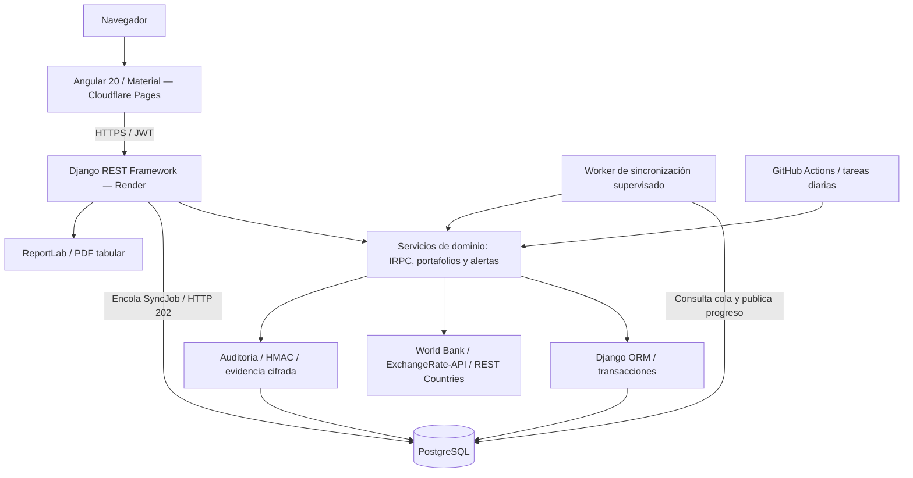
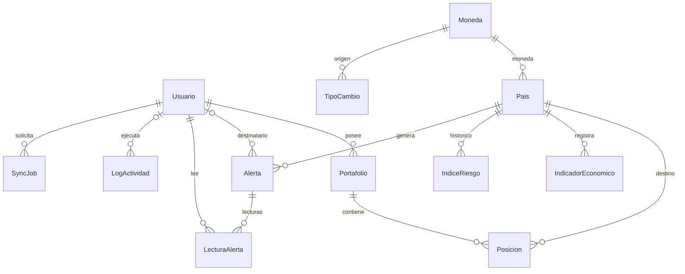

# DataPulse Latam

Aplicación full stack para consultar indicadores económicos de diez países latinoamericanos, comparar su Índice de Riesgo País Compuesto (IRPC) y administrar portafolios de inversión. Incluye dashboard con mapa y gráficos, posiciones, alertas y sincronización de datos externos.

Desarrollada como solución a la prueba técnica con **Angular 20, Django REST Framework y PostgreSQL**. Este README reúne el acceso, los diagramas, las decisiones técnicas y los pasos para evaluar y ejecutar la entrega.

## Acceso a la demostración

| Recurso | Enlace |
|---|---|
| Aplicación web | [DataPulse Latam](https://datapulse-latam.pages.dev) |
| API desplegada | [Base de la API](https://datapulse-backend-vkc5.onrender.com/api/) — las operaciones de negocio requieren JWT |
| Salud y disponibilidad | [Liveness](https://datapulse-backend-vkc5.onrender.com/api/health/) · [Readiness](https://datapulse-backend-vkc5.onrender.com/api/ready/) |
| Contrato de endpoints | [API y ejemplos](docs/API.md) · [OpenAPI](docs/openapi.yaml) |
| Evidencia automatizada | [Backend CI](https://github.com/ASamiraJasbonM/prueba-mision/actions/workflows/backend-ci.yml) · [Frontend CI](https://github.com/ASamiraJasbonM/prueba-mision/actions/workflows/frontend-ci.yml) |

| Correo | Rol | Contraseña |
|---|---|---|
| `admin@datapulse.com` | ADMIN: administración de la API y sincronización | `DataPulse2026!` |
| `analista@datapulse.com` | ANALISTA: gestión de sus portafolios | `DataPulse2026!` |
| `viewer@datapulse.com` | VIEWER: consulta y exportación, sin escritura | `DataPulse2026!` |

Estas cuentas son públicas y exclusivas de evaluación. El ADMIN desplegado no es superusuario ni tiene acceso al administrador Django. Render Free puede suspender el backend por inactividad: el primer acceso puede tardar. Los planes gratuitos no ofrecen continuidad garantizada; las condiciones operativas se describen en [despliegue](DEPLOYMENT.md).

### Recorrido recomendado para evaluar

1. Ingresar como ANALISTA y explorar el dashboard: mapa, ranking y comparación de hasta tres países.
2. Abrir un país y revisar indicadores, histórico de riesgo, tipos de cambio y calidad de las fuentes.
3. Crear un portafolio con nombre nuevo, agregar una posición y consultar distribución, riesgo ponderado y PDF.
4. Revisar las alertas, aplicar filtros y marcar lecturas.
5. Ingresar como VIEWER para comprobar que no dispone de controles de escritura.
6. Ingresar como ADMIN, pulsar **Sincronizar indicadores** y consultar el progreso y resultado; navegar o recargar conserva la ejecución.

Para probar correcciones, crear una posición nueva. Los registros antiguos sin fecha de creación acreditada no reciben un plazo de eliminación. Archivar un portafolio conserva sus posiciones y no libera su nombre.

## Alcance implementado

| Área | Comportamiento disponible |
|---|---|
| Autenticación y permisos | JWT con renovación, registro/login, perfil y permisos por rol y propietario; CAPTCHA y login MFA |
| Dashboard y países | KPIs, mapa Leaflet, ranking, gráficos Chart.js, filtros e históricos de indicadores y riesgo |
| IRPC | Cálculo decimal, desglose de penalizaciones, clasificación, histórico y faltantes explícitos |
| Portafolios | CRUD con archivo lógico, posiciones, límites de inversión, resumen, distribuciones y PDF tabular |
| Concurrencia | Transacciones y bloqueo del portafolio en PostgreSQL, versión y rechazo de escrituras desactualizadas con HTTP 409 |
| Alertas | Filtros, lectura individual/global por usuario y actualización periódica por polling |
| Sincronización | Integraciones, comandos programables y cola persistente para solicitudes ADMIN, con progreso y errores |
| Trazabilidad y operación | Logs JSON, auditoría con HMAC, evidencia cifrada para correcciones, readiness y despliegue condicionado a CI |

El seed reproducible carga diez países, seis indicadores por país durante cinco años, 31 fechas de tipos de cambio, dos portafolios de ejemplo y sus posiciones, usuarios de los tres roles e índices calculados. Su contenido es **sintético**; las sincronizaciones reemplazan los registros disponibles sin ocultar su procedencia. La base desplegada puede evolucionar por mantenimiento y uso de los evaluadores.

## Arquitectura de la solución



Las consultas de dashboard y portafolios utilizan datos persistidos; no necesitan consultar proveedores externos en cada petición. La API comprueba permisos y formatos, los servicios coordinan reglas y transacciones, y la base protege relaciones y restricciones. El worker y las tareas programadas actualizan esa misma información. REST Countries está preparado, pero pendiente de validación real con clave.

### Modelo entidad-relación

Modelo principal del dominio; las tablas auxiliares de seguridad, caché y coordinación se detallan en el código y la [arquitectura ampliada](docs/ARQUITECTURA.md).



`Moneda` permite que varios países compartan divisa. `LecturaAlerta` conserva el estado de lectura por usuario, incluidas las alertas globales. Un evento de auditoría puede no tener usuario cuando lo genera un comando de sistema.

### Decisiones técnicas y alternativas

| Decisión | Motivo y alternativa considerada |
|---|---|
| Angular standalone, rutas lazy y Material | Organización por funcionalidad y controles consistentes. Servicios observables y signals locales cubren el estado actual sin añadir NgRx. |
| Django/DRF y PostgreSQL | ORM, validación y permisos con soporte transaccional. SQLite facilita el arranque local, pero no sustituye las garantías decimales y de bloqueo de PostgreSQL. |
| Servicios de dominio y control de versión | Centralizan reglas monetarias y operaciones atómicas. Se evita que una escritura sobrescriba silenciosamente cambios posteriores. |
| Decimal en backend y strings/céntimos BigInt en frontend | Conservan precisión en importes; las conversiones a Number se limitan a gráficos. |
| Worker con cola PostgreSQL y management commands | Permiten sincronización asíncrona y programada sin introducir Celery ni un broker Redis. La operación ADMIN devuelve 202 y expone una consulta de estado. |
| Leaflet y Chart.js | Mapa y gráficos integrados directamente; cartografía local sin claves de mapas y librerías cargadas por demanda. |
| ReportLab y drf-spectacular | PDF tabular sin navegador y contrato OpenAPI generado desde la API. Swagger se habilita localmente. |
| uv y npm con archivos de bloqueo | Instalación reproducible mediante `uv.lock` y `package-lock.json`; CI verifica antes de publicar en Render y Pages. |

## Instalación y ejecución local

Requisitos: **Python 3.12**, **uv 0.13.9**, **Node.js 22.12+ de la rama 22** y npm. Ejecutar desde la raíz del repositorio clonado.

### 1. Configurar e iniciar el backend

```powershell
uv sync --frozen
uv run --frozen python scripts/setup_local.py
uv run --frozen python backend/manage.py check
uv run --frozen python backend/manage.py migrate
uv run --frozen python backend/manage.py seed_data
uv run --frozen python backend/manage.py runserver 127.0.0.1:8000
```

El inicializador crea `.env` desde [`.env.example`](.env.example), genera claves independientes y conserva cualquier configuración existente. El arranque por defecto usa SQLite y no necesita claves de proveedores: el seed funciona sin red. No ejecutar el seed en una base con datos reales.

### 2. Iniciar el worker en otra terminal, desde la raíz

```powershell
uv run --frozen python backend/manage.py procesar_sincronizaciones
```

Es necesario para procesar la sincronización solicitada desde el dashboard. Las consultas normales no lo necesitan en el entorno local por defecto.

### 3. Iniciar el frontend en otra terminal

```powershell
cd frontend
npm ci
npm start
```

Abrir [frontend local](http://127.0.0.1:4200), [API local](http://127.0.0.1:8000/api/) y [Swagger local](http://127.0.0.1:8000/api/docs/). El proxy de Angular redirige `/api` al backend. Las cuentas del seed usan las credenciales de la tabla anterior; el seed no restablece contraseñas existentes.

### Alternativa: stack Docker

Con Docker Compose disponible, generar primero `.env` con el inicializador anterior. Para utilizar PostgreSQL en los contenedores, ajustar `DATABASE_URL` en `.env` con el usuario `datapulse`, la contraseña generada en `POSTGRES_PASSWORD`, el host `db`, puerto `5432` y base `datapulse`; activar `CACHE_SHARED=True`. No usar `localhost` como host de la base dentro del contenedor.

```powershell
docker compose up -d --build frontend
docker compose run --rm backend uv run --frozen --no-sync --no-dev python backend/manage.py seed_data
docker compose ps
```

[compose.yaml](compose.yaml) inicia base, backend con migraciones y worker, y frontend en [http://127.0.0.1:8080](http://127.0.0.1:8080). El puerto 8000 debe estar libre. `docker compose down` conserva los volúmenes; `down -v` elimina los datos. Ver [configuración detallada](REFERENCIA_TECNICA.md).

## Pruebas y evidencia

Desde la raíz, con dependencias instaladas:

```powershell
uv run --frozen coverage run backend/manage.py test
uv run --frozen coverage report
uv run --frozen python backend/manage.py makemigrations --check --dry-run
uv run --frozen python scripts/check_numeric_policy.py
```

Para verificar bloqueos y precisión en PostgreSQL, con `.env` configurado para Docker como se indicó arriba:

```powershell
docker compose --profile test run --rm test-postgresql
```

La cuenta de pruebas necesita permiso para crear una base efímera. SQLite omite los casos específicos de PostgreSQL; sus resultados no acreditan concurrencia real en ese motor.

Frontend, desde su carpeta:

```powershell
cd frontend
npm run test:coverage
npm run build
npx playwright install chromium
npm run build:e2e
npm run test:e2e
```

Karma requiere Chrome/Chromium; si no se detecta, configurar `CHROME_BIN`. Playwright levanta una API real con base temporal aislada y proveedores controlados; no utiliza ni modifica la base desplegada. Ver [escenarios y requisitos E2E](docs/E2E.md).

CI ejecuta pruebas backend en SQLite y PostgreSQL, pruebas Angular y E2E en desktop/tablet, validación de contrato y controles de seguridad. Los mínimos de cobertura son 90% de líneas backend y, en frontend, 80% de sentencias, 72% de ramas, 75% de funciones y 85% de líneas. Consultar las ejecuciones **del commit evaluado** en los enlaces de CI; los informes fechados conservan resultados históricos.

## API, errores y trazabilidad

El [contrato API](docs/API.md) documenta endpoints, autenticación Bearer, filtros, paginación y payloads. Swagger y el esquema se habilitan localmente con `API_DOCS_ENABLED=True`; están desactivados en la demo pública. Para generar y validar el esquema:

```powershell
uv run --frozen python backend/manage.py spectacular --validate --fail-on-warn --file docs/openapi.yaml
```

Los errores de la API siguen la estructura `{ "error": { "code": "...", "message": "...", "details": {} } }`. Se distinguen datos inválidos (400), autenticación (401), permisos (403), recurso no visible/inexistente (404), conflicto de versión (409), cuotas (429) y dependencia operativa no disponible (503).

Las escrituras de portafolios usan versión; DELETE exige `If-Match`. Ante 409 el cliente relee y solicita revisión, sin reintentar la escritura automáticamente. Los logs JSON registran evento, fecha UTC, nivel y metadatos seguros, sin contraseñas, tokens ni cuerpos de solicitudes. La auditoría conserva actividad de usuarios y tareas de sistema.

## Fuentes, decisiones del enunciado y límites

- **Datos externos:** World Bank y ExchangeRate-API tienen sincronizaciones reales acreditadas. REST Countries tiene cliente y pruebas controladas, pero falta una clave personal y su validación real independiente. Fuentes y atribución: [FUENTES](docs/FUENTES.md).
- **Histórico y calidad:** no todo el contenido es externo verificado. Se muestran procedencia, antigüedad y faltantes. La ventana cambiaria externa se acumula diariamente; no se presenta el histórico sintético como histórico real.
- **IRPC:** mayor puntuación significa menor riesgo. El PDF presenta diferencias entre pseudocódigo y ejemplo numérico; se documentan los umbrales y el criterio de conteo aplicado. Para ese ejemplo, la interpretación implementada produce 72 en lugar de 69. Ver [decisiones y pruebas de cálculo](REFERENCIA_TECNICA.md#decisiones-irpc-y-fechas).
- **Correcciones:** archivar un portafolio conserva el historial. La eliminación física adicional de una posición abierta solo se permite durante 24 horas desde su creación acreditada, con motivo y evidencia cifrada. No existe deshacer automático. Ver [política de corrección y archivo](docs/POLITICA_CORRECCIONES.md).
- **Extensiones y pendientes:** PDF tabular disponible; gráficos dentro del PDF, XLSX y WebSockets no implementados. Alertas usan polling. Login MFA disponible; pantalla de enrolamiento pendiente. JWT se conserva en localStorage según el ejercicio. Las [adaptaciones del contrato](docs/API.md#extensiones-respecto-al-pdf) están identificadas.
- **Disponibilidad:** Render/Pages usan planes gratuitos. El despliegue y las comprobaciones de salud no constituyen una garantía de continuidad del hosting.

## Documentación para profundizar

| Documento | Contenido |
|---|---|
| [Estado actual](docs/ESTADO_ACTUAL.md) | Evidencia de integraciones y limitaciones vigentes |
| [Arquitectura](docs/ARQUITECTURA.md) | Capas, modelo relacional y decisiones ampliadas |
| [API](docs/API.md) | Endpoints, payloads, permisos y extensiones |
| [Despliegue](DEPLOYMENT.md) | Render, Pages, variables y tareas diarias |
| [Pruebas E2E](docs/E2E.md) | Escenarios de navegador y aislamiento |
| [Seguridad](docs/SEGURIDAD.md) · [Política de divulgación](SECURITY.md) | Controles y límites de seguridad |
| [Referencia técnica](REFERENCIA_TECNICA.md) | Detalle operativo y de cálculo conservado del README anterior |
| [Etapas](docs/ETAPAS.md) | Historial de implementación y resultados fechados |
