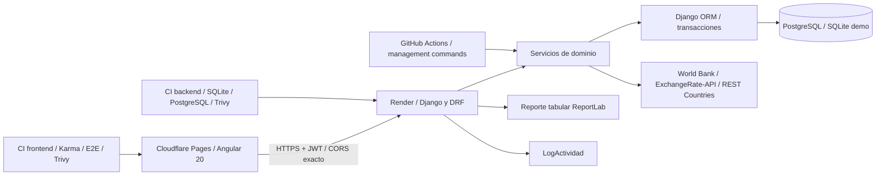
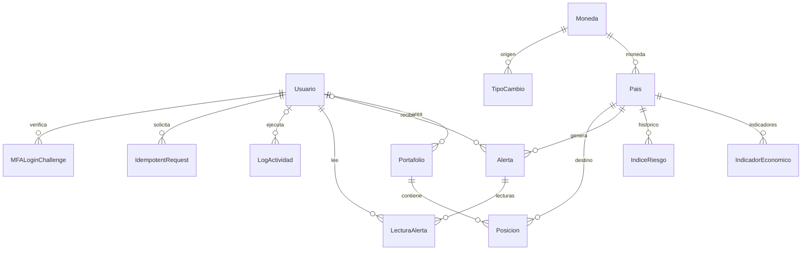

# Arquitectura vigente y modelo ER

Estado actual: aplicación full stack en `main`. Los informes fechados por etapa
son evidencia histórica; [ESTADO_ACTUAL](ESTADO_ACTUAL.md) resume la entrega vigente.

La capa API valida formatos/campos y permisos; servicios coordinan invariantes cruzadas y transacciones; modelos validan invariantes simples; DB protege claves y checks incluso ante escrituras directas. `Moneda` permite compartir divisa sin convertir el código del país en clave de divisa.

Las escrituras de posiciones bloquean siempre el portafolio padre: versiones y límites se calculan dentro del mismo bloqueo. Los consumidores deben enviar la versión obtenida de GET detalle/resumen y refrescar tras cualquier escritura.

Angular usa componentes standalone, rutas lazy por feature y Angular Material.
Autenticación, alertas y portafolios mantienen estado observable; signals cubren el
estado local de componentes. Los importes viajan como strings y se validan en
céntimos BigInt; Number se reserva para representar gráficos. La sesión se restaura
desde el perfil del servidor, con renovación JWT compartida, guards y logout entre
pestañas. CAPTCHA y login MFA están integrados; el enrolamiento MFA por UI es opcional
y sigue pendiente. Las banderas y cartografía se sirven como assets locales bajo CSP.

Alternativas: management commands en lugar de Celery evitan broker/worker. Los jobs
de indicadores y monedas son independientes, con secretos del entorno de GitHub
restringido a `main`, PostgreSQL externo con TLS y verificación de auditoría antes y
después. World Bank usa consultas agrupadas y fallback por país. Los datos anteriores
se conservan ante fallos; estos se reflejan en los informes y en el código de salida.
La sincronización programada no depende del timeout HTTP de Gunicorn; la operación
ADMIN bajo demanda mantiene su contrato síncrono.

ReportLab genera un PDF tabular sin navegador. Django-environ centraliza configuración.
SimpleJWT evita sesiones web para API; el Admin mantiene sesión/CSRF independiente.
DRF Spectacular valida el contrato; Swagger está disponible localmente y desactivado
en la demo pública. Render aplica migraciones al arrancar; seed y preparación de
cuentas demo son pasos explícitos, nunca parte de cada reinicio. El backend publica
su commit en health y Pages en deployment.json. El despliegue espera todos los gates,
incluido el E2E real con SPA de producción y base efímera en desktop/tablet.

Las tres integraciones solo actualizan datos persistidos; consultas de dashboard/portafolio no dependen de una API externa disponible. Ningún dato financiero usa FloatField ni conversiones float. La limitación decimal de SQLite está descrita en README.

La cadena de LogActividad es append-only, con hash y HMAC. AuditHead es un singleton
que serializa anexos: no es una FK adicional de dominio. Las claves de cifrado y
auditoría se conservan entre despliegues; el inicializador local nunca sobrescribe
un `.env` existente. Las credenciales públicas pertenecen únicamente a la demo.

El IRPC se calcula en Decimal sin redondeo intermedio. El valor final se cuantiza a 2 decimales ROUND_HALF_UP y se clasifica contra los umbrales 75/50/25 sobre el valor cuantizado.

Decisión explícita de auditoría: `LogActividad.usuario` es nullable para comandos sin sesión, una adaptación del modelo descrito en el PDF. No se usa usuario técnico. El resto del evento conserva su procedencia mediante entidad, acción, detalle y fecha UTC. La consulta GET `/api/auditoria/` es de solo lectura y exige rol ADMIN; los eventos de sistema exponen `usuario: null`.
