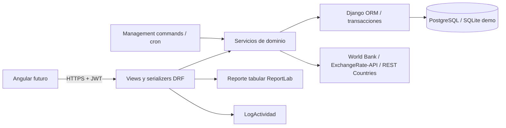
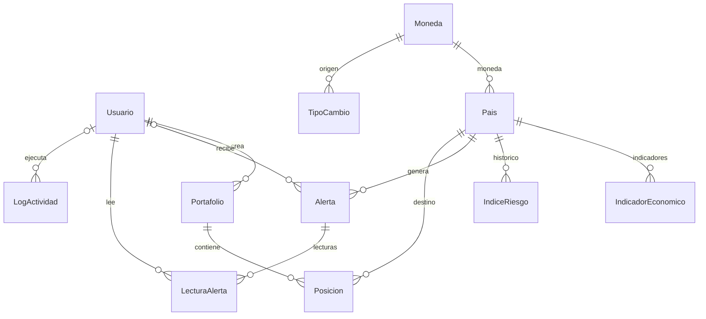

# Arquitectura y modelo ER

La capa API valida formatos/campos y permisos; servicios coordinan invariantes cruzadas y transacciones; modelos validan invariantes simples; DB protege claves y checks incluso ante escrituras directas. `Moneda` permite compartir divisa sin convertir el código del país en clave de divisa.

Las escrituras de posiciones bloquean siempre el portafolio padre: versiones y límites se calculan dentro del mismo bloqueo. Los consumidores deben enviar la versión obtenida de GET detalle/resumen y refrescar tras cualquier escritura.

Alternativas: comandos en lugar de Celery para evitar broker/worker en esta prueba; BehaviorSubject queda para frontend, no se implementa aquí. ReportLab genera un PDF tabular sin dependencia de navegador ni motor HTML. Django-environ centraliza configuración. SimpleJWT evita sesiones web para API; el Admin mantiene su sesión/CSRF independiente. DRF Spectacular valida el contrato y Swagger lo hace navegable.

Las tres integraciones solo actualizan datos persistidos; consultas de dashboard/portafolio no dependen de una API externa disponible. Ningún dato financiero usa FloatField ni conversiones float. La limitación decimal de SQLite está descrita en README.

El IRPC se calcula en Decimal sin redondeo intermedio. El valor final se cuantiza a 2 decimales ROUND_HALF_UP y se clasifica contra los umbrales 75/50/25 sobre el valor cuantizado.
