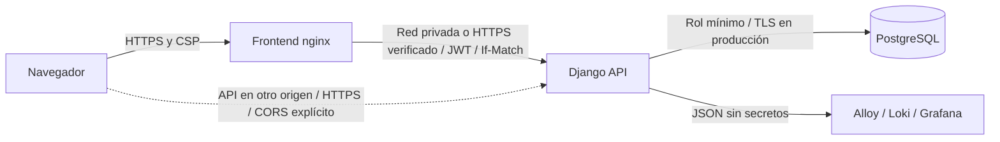

# Integración segura (U2; monitoreo U1 y recuperación U3)



## Verificación por despliegue

```sh
curl --fail -I https://<frontend>/
curl --fail --silent --show-error -D - -o /dev/null https://<backend>/api/health/
curl -i -X OPTIONS https://<backend>/api/auth/me/ \
  -H 'Origin: https://<frontend>' -H 'Access-Control-Request-Method: GET' \
  -H 'Access-Control-Request-Headers: authorization,if-match,idempotency-key'
```

- Comprobar CSP connect-src self o el origen exacto de API; no wildcard.
- HSTS en conexión HTTPS backend, DENY/nosniff/Permissions-Policy/no-store auth.
- CORS_ALLOWED_ORIGINS incluye solo origen frontend si hay acceso entre orígenes;
  el proxy same-origin /api/ no requiere CORS en el navegador.
- TRUST_PROXY_SSL_HEADER solo con backend privado y cabecera limpiada por proxy.
- Demo aislada: login con ADMIN/ANALISTA/VIEWER del README; no usar seed en producción.
- Token vencido: refresh válido puede renovar; si refresh vence/revocado, re-login
  preserva returnUrl y no muestra tokens ni trazas. No afirmar que todo401 fuerza
  re-login inmediato: el cliente existente primero intenta refresh.
- 403 por rol y acceso privado404: no mostrar recurso ni datos previos de otra sesión.
- Verificar DELETE conserva If-Match fuerte y POST opcionales Idempotency-Key.

Revisión de fuente: Angular usa interpolaciones/textContent para datos API; no
introduce SECRET_KEY ni imprime tokens en logs. localStorage guarda JWT: XSS puede
leerlo; CSP/escape no lo convierten en HttpOnly. Revisar extensiones y nuevas
dependencias. Ver [SEGURIDAD_FRONTEND](SEGURIDAD_FRONTEND.md#verificación-cruzada).

## Límite de compatibilidad

El endurecimiento Angular posterior incorpora CAPTCHA en registro/login y el
segundo POST para ADMIN enrolado, con TOTP o recovery en code. Se verificó contra
backend real aislado, incluido logout entre pestañas, sin violaciones CSP. La demo
habitual conserva seed sin MFA y configuración local; no se desactivan controles
del backend para hacer funcionar la interfaz. TODO página opcional de enrolamiento
MFA, TLS/domino real y alternativa accesible para CAPTCHA. Ver
[validación frontend](VALIDACION_SEGURIDAD_FRONTEND.md).

Las pruebas backend verifican cabeceras/CORS existentes y permisos; el checklist
HTTPS depende de los dominios/certificados reales, ausentes en este entorno.
[SEGURIDAD §9](SEGURIDAD.md#9-integración-u2), [SIEM](SIEM.md), [RESTORE](RESTORE.md).
